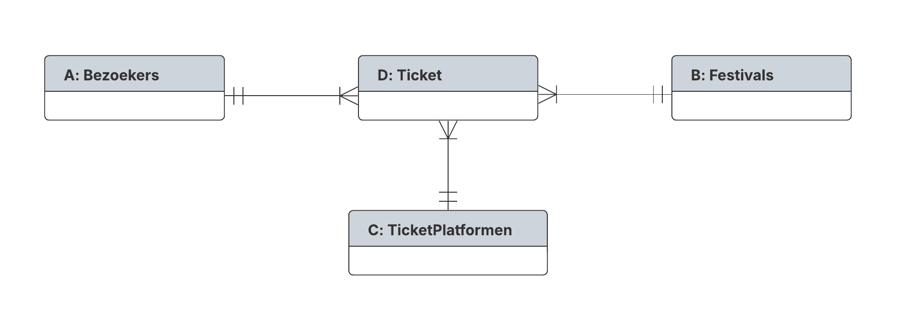

Milestone 1: analyse 0NF
--

* **teamnaam:**  `INF202_4_TDR_romeo_jonas`
* **S1:** `Romeo Weyns`
* **S2:** `Jonas Friedhoff`

Student S1 - Veel op veel - `Romeo Weyns`
--

1 Conceptueel model
--
S1:

- **A:** Bezoekers
- **B:** Festivals
- **C:** TicketPlatformen
- **D:** Ticket

ONF S1
--

- **Ticket_ID(PK) : VARCHAR**
- Ticket_Price : NUMBER
- Ticket_Date : DATE
- Ticket_Purchase_Date : DATE
- Ticket_Description : VARCHAR
- Ticket_Barcode : VARCHAR
- Ticket_Type : VARCHAR
- Ticket_Status : VARCHAR
- Ticket_QR_Code : VARCHAR
- TicketPlatform_ID : VARCHAR
- TicketPlatform_Name : VARCHAR
- TicketPlatform_URL : VARCHAR
- Visitor_ID : VARCHAR
- Visitor_Firstname : VARCHAR
- Visitor_Lastname : VARCHAR
- Visitor_Birthdate : DATE
- Visitor_Email : VARCHAR
- Visitor_Street : VARCHAR
- Visitor_Zipcode : VARCHAR
- Visitor_City : VARCHAR
- Visitor_Country : VARCHAR
- Visitor_Gender : VARCHAR
- Festival_ID : VARCHAR
- Festival_Company : VARCHAR
- Festival_Founding_Year : INTEGER
- Festival_Name : VARCHAR
- Festival_StartDate : DATE
- Festival_EndDate : DATE
- Festival_Location : VARCHAR
- Festival_Country : VARCHAR
- Festival_Opening_Hour : VARCHAR
- Festival_Closing_Hour : VARCHAR
- Festival_Capacity : INTEGER

---

- **Festival_ID(PK) : VARCHAR**
- Festival_Company : VARCHAR
- Festival_Founding_Year : INTEGER
- Festival_Name : VARCHAR
- Festival_StartDate : DATE
- Festival_EndDate : DATE
- Festival_Location : VARCHAR
- Festival_Country : VARCHAR
- Festival_Opening_Hour : VARCHAR
- Festival_Closing_Hour : VARCHAR
- Festival_Capacity : INTEGER
- Permit_ID : VARCHAR
- Permit_Category : VARCHAR
- Permit_Description : VARCHAR
- Permit_Reception_Date : DATE
- Permit_Expiration_Date : DATE
- Permit_Application_Date : DATE

---

Student 2 - 2 niveau's diep - `Jonas Friedhoff`
--

Conceptueel model
--

- **W:** Artiesten
- **X:** Festivals
- **Y:** Stages
- **Z:** Optreden

3 ONF S2
--

- **Festival_ID(PK) : VARCHAR**
- Festival_Name : VARCHAR
- Festival_Description : VARCHAR
- Festival_Location_City: VARCHAR
- Festival_Location_Country : VARCHAR
- Festival_Price : NUMBER
- Festival_Visitor_Count : INTEGER
- Festival_Date : DATE
- Stage_Name : VARCHAR
- Stage_Style_Description : VARCHAR
- Stage_Standing_Capacity : INTEGER
- Stage_Toilet_Count : INTEGER
- Stage_Description : VARCHAR
- Stage_Roofed_Status  : BOOLEAN
- Artist_Name : VARCHAR
- Artist_Birthdate : DATE
- Artist_Price : NUMBER
- Artist_Land_Of_Birth : VARCHAR
- Performance_Start_Time : NUMBER
- Performance_End_Time : NUMBER
- Performance_Description : VARCHAR
- Genre_Name : VARCHAR
- Genre_Origin_Year : INTEGER
- Genre_Origin_Place : VARCHAR
- Genre_BPM : INTEGER