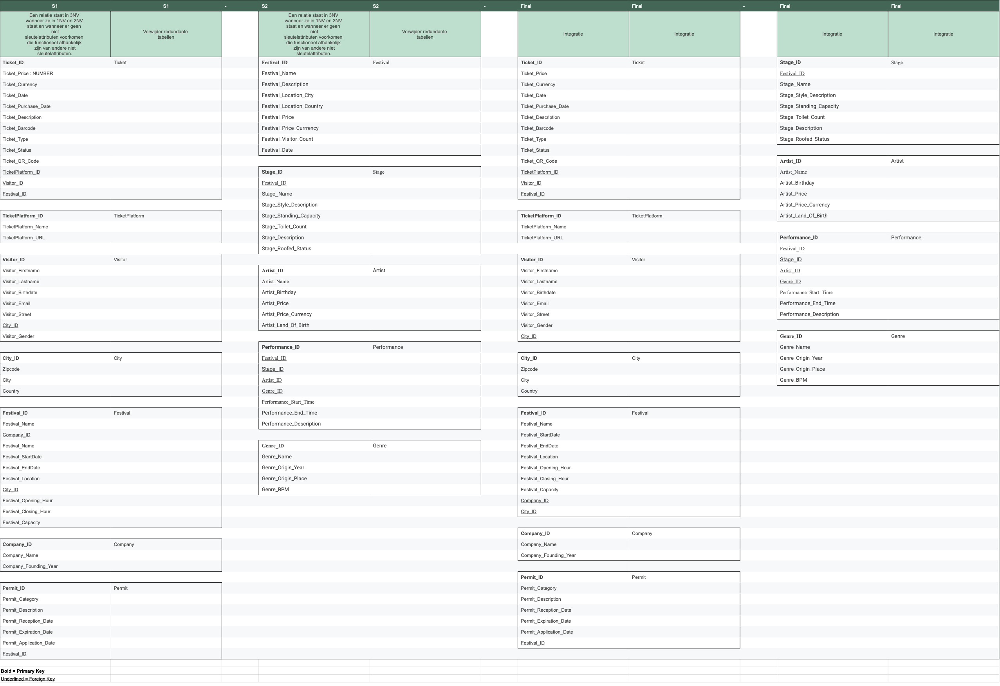

Milestone 2: Normalisation/Integration
--

Step 1 Normalisation
--

    S1
[S1_normalisatie.pdf](..%2FS1_normalisatie%2FS1_normalisatie.pdf)

    S2
[S2_normalisatie.pdf](..%2FS2_normalisatie%2FS2_normalisatie.pdf)

Step 2: Integration
--
[SAMEN_integratie.pdf](SAMEN_integratie.pdf)

Step 3: Domain - constraints
--- 
    S1
- Ticket: price > 0
- Ticket: barcode between 8 and 14 characters
- Visitor: birthdate - (positive) integer & < current_date
- Festival: end_date > start_date
- Festival: closing_hour > opening_hour
- Festival: capacity > 0
- Company: founding_year < current_year
- Permit: reception_date < expiration_date
- Permit: application_date < reception_date

---
    S2
- Stage_Toilet_Count, Stage_Standing_Capacity, Artist_Price, Genre_BPM all >= 0
- Artist_Birthday and Genre_Origin_Year < current_date
- Artist_Land_Of_Birth must be at least 4 letters
- All currencies must be 3 letters 

Time
---
- S1: Festival: The festival start_date and end_date keep track of the history.
- S1: Permit: The permit reception_date and expiration_date keep track of the history.
- S2: Genre_Origin_Year must be before the Festival_Date
- S2: Artist_Birthday must be before the Festival_Date