Milestone 3: Creatie Databank en Security
---

    Identity columns
---
- Mandatory
    **
- - A: Vi
- sitor: Visitor_ID**
  - B/X: Festival: Festival_ID 
  - C: TicketPlatform: TicketPlatform_ID
  - D: Ticket: Ticket_ID
  - W: Artist: Artist_ID
  - Y: Stage: Stage_ID
  - Z: Performance: Performance_ID
- other:
    - Company: Company_ID
    - City: City_ID
    - Permit: Permit_ID
    - Genre: Genre_ID

      Table Counts
---
     Tablecounts


Queries
--- 
    S1 @query 1: VISITOR (A) - FESTIVAL (B/X) via Ticket (D) + TicketPlatform (C)
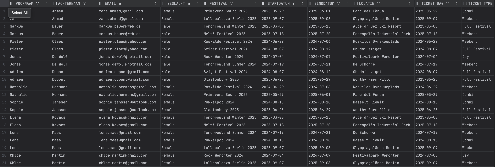
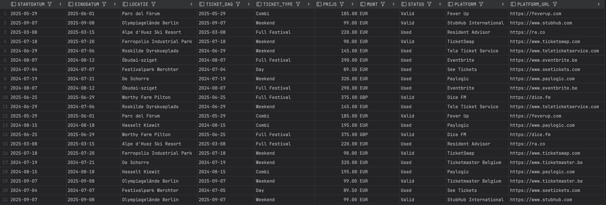

    S1 @query 2: COMPANY - FESTIVAL - PERMIT
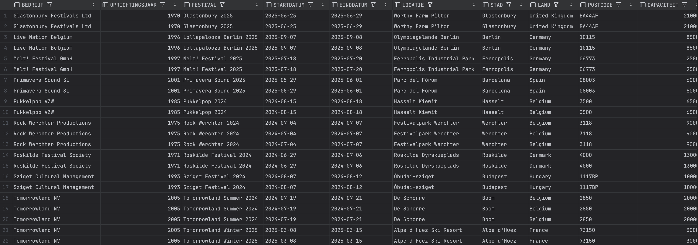
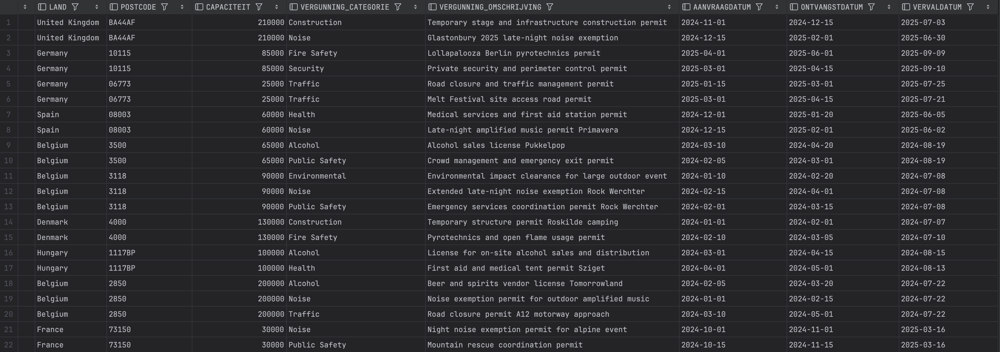

    S2 @query 1: FESTIVAL (B/X) – STAGE (Y) – PERFORMANCE (Z) – ARTIST (W) – GENRE


    S2 @query 2: ARTIST (W) – PERFORMANCE (Z) – GENRE – STAGE (Y) – FESTIVAL (B/X)


Bewijs Domeinen - constraints M2
--- 

    S1
- Company: founding year must be between 1800 and 2025, Company_Name_UQ  →  UNIQUE (Company_Name)

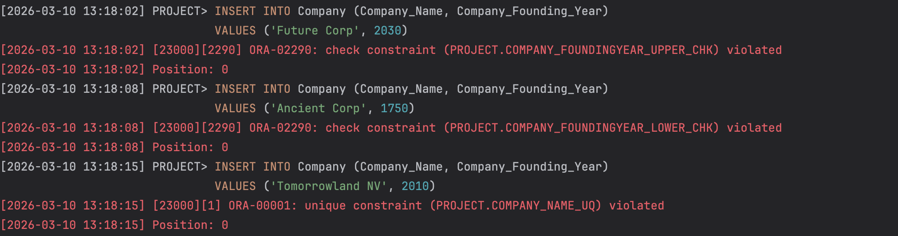

- Visitor: birthdate must be between 1900-01-01 and 2026-03-10, Visitor_Email_UQ  →  UNIQUE (Visitor_Email)

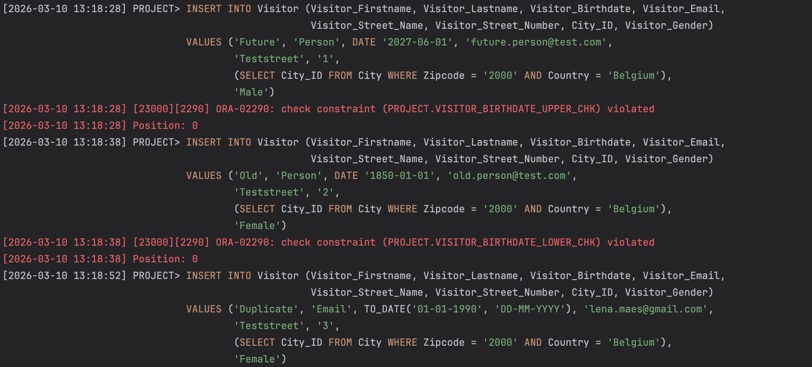

- Permit: application_date < reception_date < expiration_date

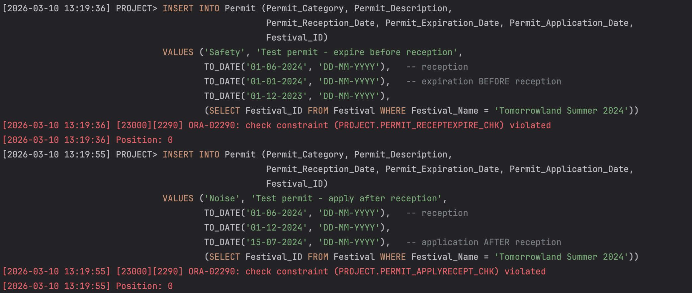

- Ticket: price > 0, barcode length between 8 and 14, purchase_date <= ticket_date, UNIQUE (Visitor_ID, Festival_ID, Ticket_Date)

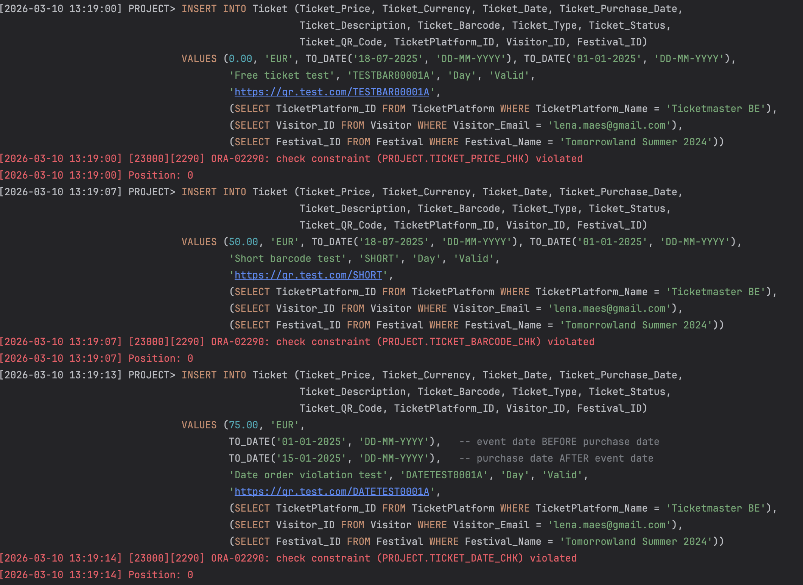
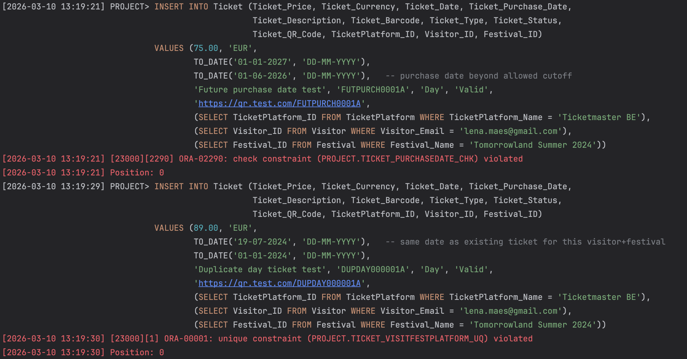

- Festival: end_date > start_date, closing_hour > opening_hour, capacity > 0

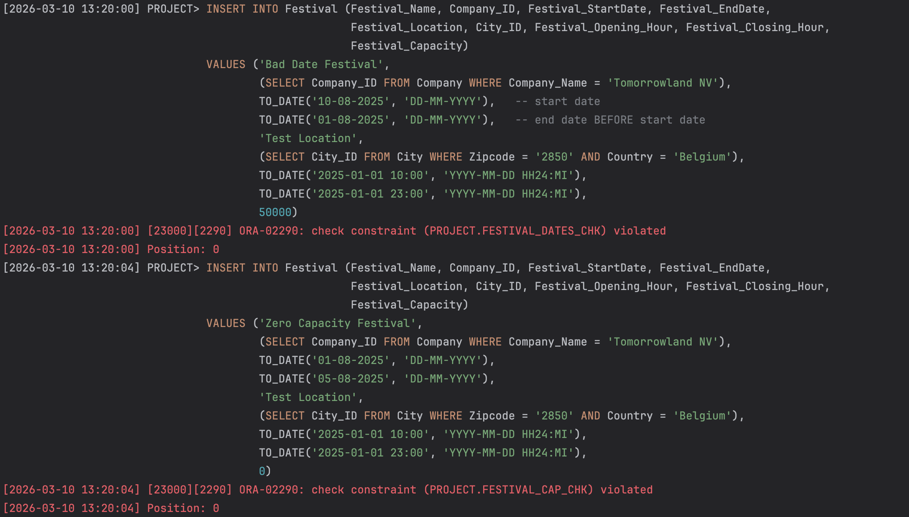

    S2
- Genre: BPM >= 0, origin year < 2026


- Artist: price >= 0, currency is 3 uppercase letters (ISO 4217), land of birth >= 4 chars, birthday < 2026-03-10


- Stage: standing capacity >= 0, toilet count >= 0, roofed status IN (0, 1), name unique per festival


- Performance: end time > start time


Security
---
IntelliJ Tree View

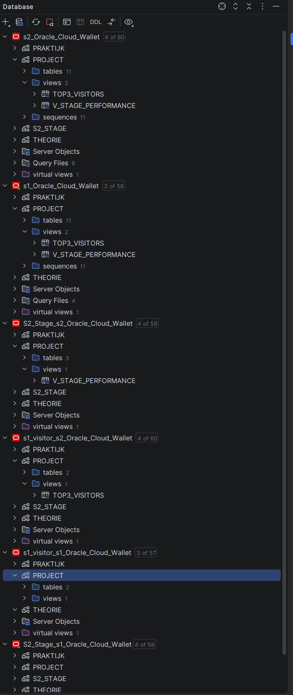

    S1: user s1_visitor, role festival_s1_role, view v_visitor_ticket

- User sys privs S1
```sql
SELECT * FROM USER_SYS_PRIVS;
```
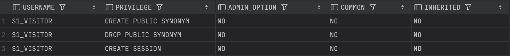

- User tab privs S1
```sql
SELECT * FROM USER_TAB_PRIVS;
```
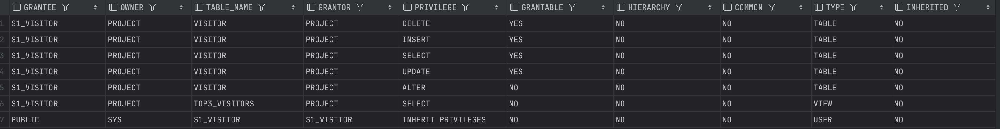

- User col privs S1
```sql
SELECT * FROM USER_COL_PRIVS;
```
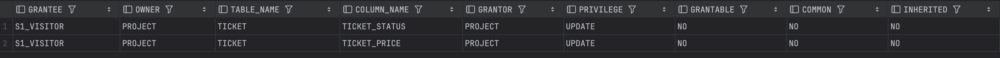

- View Topvisitors
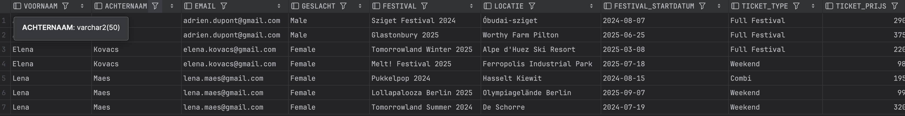


    S2: user s2_stage, role festival_s2_role, view v_stage_performance

- User tab privs S2
```sql
SELECT *
FROM USER_TAB_PRIVS
WHERE GRANTEE = (SELECT USER FROM dual);
```


- User Role privs S2
```sql
SELECT *
FROM USER_ROLE_PRIVS;
```


- Role Tab privs S2
```sql
SELECT *
FROM role_tab_privs
WHERE role = 'FESTIVAL_S2_ROLE'
ORDER BY TABLE_NAME;
```


- view v_stage_performance


- INSERT VIEW - key preserved table (Performance)
